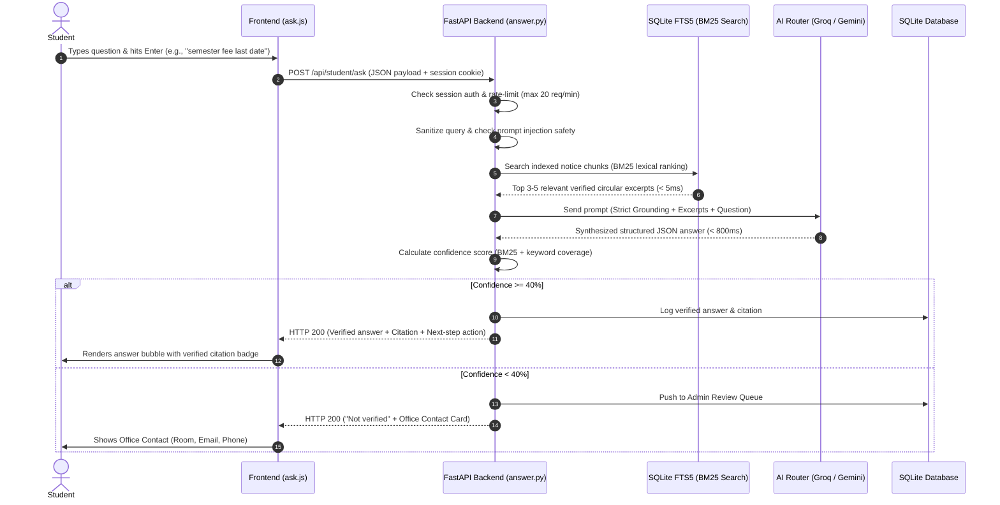

# CampusFlow AI — End-to-End Query Execution Lifecycle

This document explains step-by-step what happens behind the scenes from the exact millisecond a student types a question and hits Enter until the answer appears on their screen.

---

## 🔄 High-Level Architecture Flowchart



---

## 🔬 Detailed Step-by-Step Breakdown

### Step 1: User Input in Browser (`ask.js`)
1. The student types a question in plain English or conversational Hinglish (e.g. *"fees submit karne ki last date kya hai"*).
2. The browser JavaScript catches the submit event, disables the send button, and fires an asynchronous `fetch` request:
   ```http
   POST /api/student/ask HTTP/1.1
   Content-Type: application/json
   Cookie: session=...

   {
       "question": "fees submit karne ki last date kya hai",
       "chat_id": null
   }
   ```

---

### Step 2: Request Gatekeeping & Security (`routers/student.py`)
1. **Authentication Check:** Server inspects the signed `HttpOnly` session cookie to verify the student is logged in.
2. **Rate Limiting:** An in-memory rate limiter verifies this student hasn't exceeded 20 requests in the last 60 seconds (prevents bot attacks or spam).

---

### Step 3: Query Understanding & Sanitation (`answer.py`)
1. **Adversarial Safety Check:** Scans the text for prompt-injection attacks (e.g., *"ignore previous rules"*, *"system prompt"*, *"DAN mode"*). If detected, it immediately returns a safe default.
2. **Synonym & Keyword Normalization:** Translates common campus Hinglish terms:
   - *"fees / fee / paise"* ➔ *"tuition fee, semester fee"*
   - *"last date / kab tak"* ➔ *"deadline, due date"*

---

### Step 4: Lexical Retrieval via SQLite FTS5 (`search.py`)
Instead of sending the whole database to the LLM (which is slow, expensive, and risks hallucinations):
1. SQLite **FTS5 (Full-Text Search)** uses the **BM25 ranking algorithm** to search across thousands of indexed campus notice chunks.
2. It filters out expired notices (`is_document_expired()`).
3. In **under 5 milliseconds**, it retrieves the top 3 to 5 official circular chunks that contain the exact relevant terms.

---

### Step 5: Grounded LLM Synthesis (`llm.py`)
The backend bundles three things and sends them to the LLM:
1. **Strict System Prompt:**
   > *"You are CampusFlow AI. Answer ONLY based on the official excerpts provided. Never hallucinate. If the information is not in the text, state that it is not mentioned."*
2. **Retrieved Evidence:** The exact official paragraphs found in Step 4.
3. **Student Question:** The normalized question.

**The Multi-Provider Router:**
- First calls **Groq** (`openai/gpt-oss-20b` or `llama-3.3-70b`) for sub-second answer generation.
- If Groq rate limits, it fails over to the backup Groq key.
- If Groq is down, it fails over to **Google Gemini Flash**.
- If offline, it extracts the exact matching sentence directly from the notice.

---

### Step 6: Confidence Scoring & The "Not Verified" Circuit (`answer.py`)
Before returning the answer to the student, the system calculates a **Mathematical Confidence Score (0–100%)**:
$$\text{Confidence} = f(\text{BM25 Rank}, \text{Keyword Coverage}, \text{LLM Self-Check})$$

- **Case A: Confidence $\ge$ 40% (Verified)**
  - The answer is confirmed.
  - Builds the citation (e.g., *"Circular #Acad/2026/04 - Tuition Fee Schedule"*).
  - Generates next-step action buttons (e.g., *"Open Fee Payment Portal"*, *"Download Form"*).
- **Case B: Confidence < 40% (Not Verified)**
  - The system **refuses to guess or hallucinate**.
  - Sets answer to *"Not verified in official campus circulars"*.
  - Attaches the relevant **Campus Office Contact Card** (e.g., Accounts Cell, Room 104, phone & email).
  - Automatically logs the question into the **Admin Review Queue** so faculty can answer it once for all students.

---

### Step 7: Database Persistence & UI Display (`ui.js` & `ask.js`)
1. The question, response, confidence, and timestamp are saved into the `questions` table in `campusflow.db`.
2. The browser receives the JSON response.
3. In **under 800 milliseconds total**, the chat thread appends the assistant bubble, the verified badge, citation source drawer, and action buttons.
