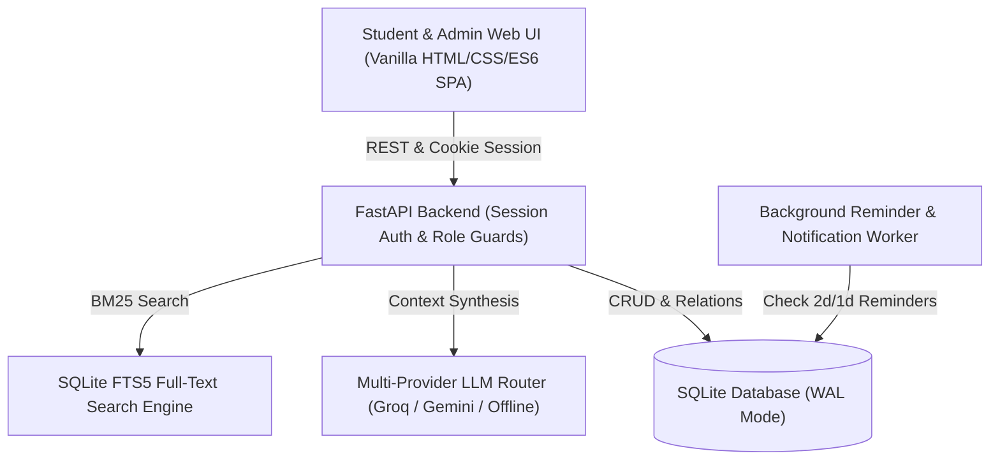
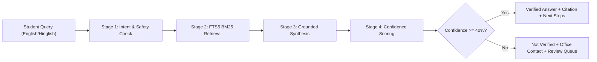

# CampusFlow AI — How It Works: Technical Architecture & Deep Dive

> **CampusFlow AI** ("Ask. Verify. Act.") is an intelligent query and action assistant built for university campuses.  
> This document explains the inner mechanics of the system, data flows, and design principles.

---

## 1. System Architecture Overview

CampusFlow AI runs on a lightweight, zero-npm Python stack designed for speed, portability, and zero external infrastructure dependencies:
1. **Frontend:** Pure HTML5, CSS custom properties (`tokens.css`, `base.css`, `components.css`), and modular ES6 JavaScript. No React, no Tailwind, no Node.js compilation.
2. **Backend:** Python FastAPI served via Uvicorn.
3. **Database:** SQLite with Write-Ahead Logging (`WAL` mode), foreign key constraints, and native `FTS5` virtual tables.
4. **LLM Engine:** Provider router prioritizing Groq (`gpt-oss-20b`), falling back to Gemini Flash, and gracefully degrading to deterministic offline notice excerpt extraction if all APIs are unavailable.

---

## 2. The Student "Ask" Pipeline

Every question submitted by a student follows a strict 5-stage verification funnel:

### Stage 1: Intent, Safety, & Context
- Queries are normalized and checked for safety. Common prompt-injection patterns (`ignore previous`, `system prompt`) are immediately rejected.
- Standard greetings (`hi`, `hello`, `namaste`) receive a conversational welcome without triggering false notice citations.
- If part of an ongoing conversation thread, previous turns are factored in to rewrite ambiguous follow-ups (e.g., *"can I pay in installments?"* -> *"can I pay semester fees in installments?"*).

### Stage 2: Full-Text Retrieval (FTS5 BM25)
- Queries are expanded with campus synonym groups (`fee` <-> `tuition`, `challan`, `payment`) and Hinglish translations (`kab` <-> `when`, `jama` <-> `pay`).
- The SQLite `chunks_fts` virtual table ranks chunks by BM25 relevance score.
- Exact query keywords receive an additional relevance boost over expanded synonyms to prioritize specific student topics.

### Stage 3: Grounded Answer Synthesis
- The top matching chunks are formatted into a constrained prompt with strict temperature (`0.0`).
- The AI is instructed: *"Answer exclusively using the facts in the official notice excerpts. If the notice does not state the answer, reply that it cannot be answered from official notices."*

### Stage 4: Grounded Confidence Formula
Confidence is computed through a deterministic 4-part formula:
$$\text{Confidence Score} = \text{round}\Big(100 \times \big(0.45 \times \text{Coverage} + 0.30 \times \text{BM25 Norm} + 0.10 \times \text{Title Hit} + 0.15 \times \text{LLM Output}\big)\Big)$$

Where:
- $\text{Coverage}$: Percentage of student keywords matching the notice text.
- $\text{BM25 Norm}$: Squashed relevance score from FTS5.
- $\text{Title Hit}$: 1.0 if query keywords appear in the document title.
- $\text{LLM Output}$: 1.0 if verified from notice text.
- **Expired Notice Penalty:** $-15\%$ if the notice's validity date has passed (marked with a prominent `OLD` badge).
- **Safety Gate:** If core keyword coverage is below $35\%$, the score is capped below threshold, guaranteeing a `Not verified` outcome.

---

## 3. Document Ingestion & Chunking

When an administrator uploads a notice (PDF, Word, Text, or Photo):

1. **Extraction:**
   - PDF files are extracted using `pypdf`.
   - Word `.docx` documents are extracted using `python-docx`.
   - Notice photos and scanned circulars use Vision OCR (`qwen/qwen3.8-27b` or Gemini Flash).
2. **Semantic Chunking:**
   - Text is split into chunks of 500 to 800 characters along natural paragraph and section boundaries.
   - Each chunk preserves section headings and a 12-word overlap with adjacent chunks to ensure continuous context.
3. **FTS5 Synchronization:**
   - Chunks are inserted into the `chunks` table and mirrored in the `chunks_fts` virtual table for instant BM25 querying.

---

## 4. Deterministic Date & Conflict Engine

To ensure university notices never mislead students, CampusFlow AI runs deterministic validation rules on every uploaded document:

- **Missing Deadline Flag (Blocking):** If the notice mentions a deadline (e.g. *"last date"*, *"submit by"*) but specifies no date.
- **Conflicting Dates Flag (Blocking):** If a deadline date occurs *before* the notice publish date or after the academic semester conclusion.
- **Relative Date Warning (Non-blocking):** Flags phrases like *"next Friday"* or *"within 2 days"* advising the admin to provide absolute dates.
- **Publish Gate:** A document with blocking flags **cannot be published** until the administrator resolves the conflict.

---

## 5. Automated Reminders & Notifications

CampusFlow AI runs a background worker embedded directly into FastAPI's lifespan:
- Every 30 seconds, the worker checks for confirmed deadlines.
- If a deadline is due within 2 days (48 hours) or 1 day (24 hours), it creates in-app notifications for students.
- When a student completes the task, they click **Mark Done** in their dashboard, which marks the deadline complete and prevents further reminder alerts.

---

## 6. Admin Review Queue: "Answer Once, Help Everyone"

When multiple students ask questions that the AI cannot verify (e.g. *"Where is the robotics lab?"*):
1. CampusFlow AI groups them by semantic keyword fingerprints (`group_key`).
2. The Admin Review Queue shows: *"Asked 8 times by 5 students"*.
3. The administrator types the verified answer once.
4. CampusFlow AI automatically:
   - Publishes an official FAQ notice.
   - Indexes the answer in FTS5.
   - Dispatches individualized notifications to all 5 students.
   - Answers future students instantly with 100% confidence.
